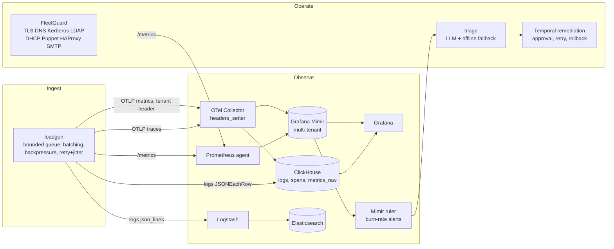

# Architecture

TelemetryScale is one platform with three planes: **ingest** (a Go pipeline that generates
and ships telemetry), **observe** (Mimir, ClickHouse, ELK, OpenTelemetry, Grafana, SLO rules),
and **operate** (FleetGuard Linux checks, GenAI triage, Temporal remediation).

## Key design decisions
| Decision | Why | Trade-off |
|---|---|---|
| Bounded queue with explicit policy (Block / DropNewest) | Unbounded buffers hide overload until the process OOMs. Block pushes backpressure to the producer; DropNewest sheds load at the edge and counts it. | Block can stall producers; Drop loses data on purpose. Benchmarked both. |
| Capped exponential backoff with full jitter | Avoids synchronised retry storms against a recovering backend. | Long outages exceed the retry budget; that is measured in `bench/outage.sh`. |
| Tenant carried as `X-Scope-OrgID`, forwarded by the Collector | Keeps Mimir multi-tenant end to end; enables the noisy-neighbour experiment. | Adds a hop; Collector must be sized. |
| SLO rules generated from one JSON spec | One source of truth; multi-window burn-rate alerts avoid both slow detection and flapping. | Spec is deliberately small; no per-service templating. |
| Stdlib-only Go for exporters and checks | No dependency drift; every parser is unit-tested with in-process fakes. | Hand-rolled OTLP JSON and a minimal LDAP bind; not full protocol clients. |
| Temporal for remediation, separate Go module | Durable state, signals for approval, built-in retry. | Extra infrastructure; kept out of the core module so core builds with no network. |
| Telemetry is fenced as untrusted in LLM triage | Log lines can carry prompt injection. | Reduces, does not eliminate, the risk; output is advisory only. |
